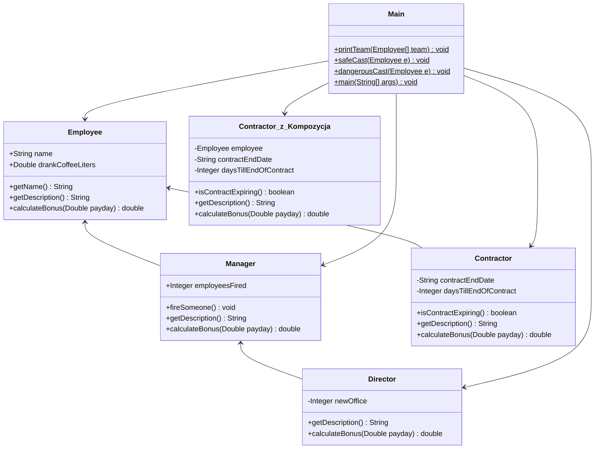

## I. Dokumentacja do lab. nr 7 - "Dziedziczenie i polimorfizm"
## II. Roch Majkowski - grupa 1, semestr III
## III. Przedmiot - "Programowanie obiektowe"

## IV. Opis zadania do realizacji

Do zrealizowania były następujące zadania:

1. Zaimplementuj hierarchię `Employee -> Manager -> Director` z metodą `getDescription()` i odpowiednimi polami charakterystycznymi dla każdej klasy.
2. Przesłoń metodę `calculateBonus()` w klasach potomnych i porównaj wyniki dla tego samego wynagrodzenia bazowego.
3. Napisz metodę `printTeam(Employee[] team)`, która demonstruje polimorfizm podczas wywołań metod na typie bazowym.
4. Dodaj przykład bezpiecznego rzutowania z użyciem `instanceof` i osobno przykład, który prowadzi do `ClassCastException`.
5. Rozbuduj hierarchię o klasę `Contractor` dziedziczącą po `Employee` (z własnym polem i metodą, np. `contractEndDate` i `isContractExpiring()`, oraz przesłoniętymi `getDescription()` i `calculateBonus()`). Następnie zaimplementuj alternatywę, w której `Contractor` zamiast dziedziczyć *zawiera* obiekt `Employee` (kompozycja) i porównaj obie wersje w 4-6 zdaniach (is-a vs has-a).
6. Narysuj prosty diagram hierarchii klas (Mermaid) i zaznacz, które metody są przesłaniane.

## V. Technologie wykorzystane w zadaniu
  - Java
  - Mermaid

## VI. Realizacja zadania
<br>

## 1. Zadanie - hierarchia `Employee -> Manager -> Director`

Kod wykorzystany do rozwiązania zadania (zadań):

### Klasa `Employee`

```java
package TheOffice;

public class Employee {
    protected String name;
    protected Double drankCoffeeLiters;

    public Employee(String name, Double drankCoffeeLiters) {
        this.name = name;
        this.drankCoffeeLiters = drankCoffeeLiters;
    }

    public String getName() {
        return name;
    }

    public String getDescription() {
        return name + ", drank " + drankCoffeeLiters + " liters of coffee.";
    }

    public double calculateBonus(Double payday) {
        return 200 + payday;
    }
}
```

### Klasa `Manager`

```java
package TheOffice;

public class Manager extends Employee {
    protected Integer employeesFired;

    public Manager(String name, Double drankCoffeeLiters, Integer employeesFired) {
        super(name, drankCoffeeLiters);
        this.employeesFired = employeesFired;
    }

    public void fireSomeone() {
        System.out.println(name + " kogoś zwolnił."); // metoda do zadania 4
    }

    @Override
    public String getDescription() {
        return super.getDescription() + " Has fired " + employeesFired + " employees from the company.";
    }

    @Override
    public double calculateBonus(Double payday) {
        return (200 + payday) * 1.1;
    }
}
```

### Klasa `Director`

```java
package TheOffice;

public class Director extends Manager {
    private Integer newOffice;

    public Director(String name, Double drankCoffeeLiters, Integer employeesFired, Integer newOffice) {
        super(name, drankCoffeeLiters, employeesFired);
        this.newOffice = newOffice;
    }

    @Override
    public String getDescription() {
        return super.getDescription() + " Otworzył nowych biur: " + newOffice;
    }

    @Override
    public double calculateBonus(Double payday) {
        return ((200 + payday) * 1.1) * 2.5;
    }
}
```

### Klasa `Main` (fragment)

```java
Employee[] employees = {
        new Employee("Janek", 3.0),
        new Manager("Bartłomiej", 12.6, 47),
        new Director("Waldemar",72.2,234,4),
        new Contractor("Jakub", 824.1, "2026-11-23", 5)
};
```

#### 1a. Zrzuty ekranu pokazujące wynik działania aplikacji/skryptu:


#### 1b. Struktura projektu/programu:


#### 1c. Wnioski:
- `Manager` dziedziczy po `Employee`, a `Director` po `Manager`, więc `Director` ma pola i metody wszystkich trzech klas.
- Każda klasa ma własne pole charakterystyczne.

<br>

## 2. Zadanie - metoda `calculateBonus()`

Kod wykorzystany do rozwiązania zadania (zadań):

Metoda `calculateBonus(Double payday)` jest zdefiniowana w klasie `Employee` i przesłonięta z `@Override` w odpowiednich klasach. Oto są kalkulacje dla poszczególnych klas:

- `Employee` =>`200 + payday` = 4200.0
- `Manager` => `(200 + payday) * 1.1` = 4620.0
- `Director` => `((200 + payday) * 1.1) * 2.5` = 11550.0
- `Contractor` => `super.calculateBonus(payday) * 4` = 16800.0

#### 2a. Zrzuty ekranu pokazujące wynik działania aplikacji/skryptu:


#### 2b. Struktura projektu/programu:


#### 2c. Wnioski:
Dla tego samego wynagrodzenia bazowego każda klasa zwraca inną premię, bo każda ma własną wersję `calculateBonus()`

<br>

## 3. Zadanie - metoda `printTeam(Employee[] team)`

Kod wykorzystany do rozwiązania zadania (zadań):

### Klasa `Main` (fragment)

```java
static void printTeam(Employee[] team) {
    for (Employee employee : team) {
        System.out.println(employee.getDescription());
        System.out.println("Wynagrodzenie" + employee.calculateBonus(4000.0));
    }
}
```

Wywołanie w `main`:

```java
printTeam(employees); // Zadanie 3, wywołanie
```

#### 3a. Zrzuty ekranu pokazujące wynik działania aplikacji/skryptu:


#### 3b. Struktura projektu/programu:


<br>

## 4. Zadanie - rzutowanie i `instanceof`

Kod wykorzystany do rozwiązania zadania (zadań):

### Klasa `Main` (fragment)

```java
static void safeCast(Employee e) {
    if (e instanceof Manager m) {
        m.fireSomeone();
    } else {
        System.out.println(e.getName() + " Pracownik nie jest managerem!");
    }
}

static void dangerousCast(Employee e) {
    Manager m = (Manager) e;
    m.fireSomeone();
}
```

Wywołanie w `main`:

```java
safeCast(employees[1]); // Zadanie 4, instanceOf
safeCast(employees [0]); // Zadanie 4, instanceOf

// Try/Catch dla zadania 4

if (args.length > 0 && args[0].equals("crash")) {
    dangerousCast(employees[0]);
} else {
    try {
        dangerousCast(employees[0]);
    } catch (ClassCastException ex) {
        System.out.println("Błąd: " + ex.getMessage());
    }
}
```

#### 4a. Zrzuty ekranu pokazujące wynik działania aplikacji/skryptu:


#### 4b. Struktura projektu/programu:


<br>

## 5. Zadanie - klasa `Contractor` i `Contractor_z_Kompozycja`

Kod wykorzystany do rozwiązania zadania (zadań):

### klasa `Contractor`

```java
package TheOffice;

public class Contractor extends Employee {
    private String contractEndDate;
    private Integer daysTillEndOfContract;

    public Contractor(String name, Double drankCoffeeLiters, String contractEndDate, Integer daysTillEndOfContract) {
        super(name, drankCoffeeLiters);
        this.contractEndDate = contractEndDate;
        this.daysTillEndOfContract = daysTillEndOfContract;
    }

    public boolean isContractExpiring() {
        return daysTillEndOfContract <= 7;
    }

    @Override
    public String getDescription() {
        return super.getDescription() + " Pozostałe dni do końca umowy: " + contractEndDate;
    }

    @Override
    public double calculateBonus(Double payday) {
        return super.calculateBonus(payday) * 0.5;
    }
}
```

### klasa `Contractor_z_Kompozycja`

```java
package TheOffice;

public class Contractor_z_Kompozycja {
    private final Employee employee;
    private final String contractEndDate;
    private final Integer daysTillEndOfContract;

    public Contractor_z_Kompozycja(String name, Double drankCoffeeLiters, String contractEndDate, Integer daysTillEndOfContract){
        this.employee = new Employee(name, drankCoffeeLiters);
        this.contractEndDate = contractEndDate;
        this.daysTillEndOfContract = daysTillEndOfContract;
    }

    public boolean isContractExpiring() {
        return daysTillEndOfContract <= 7;
    }

    public String getDescription() {
        return employee.getDescription() + " Pozostałe dni do końca umowy: " + contractEndDate;
    }

    public double calculateBonus(Double payday) {
        return employee.calculateBonus(payday) * 0.5;
    }

}
```

### Klasa `Main` (fragment)

```java
Contractor contractor = (Contractor) employees[3]; // Zadanie 5
System.out.println(contractor.getDescription() + " Wygasza? " + contractor.isContractExpiring());

Contractor_z_Kompozycja contractorZKompozycja = new Contractor_z_Kompozycja("Jakub", 824.1, "2026-11-23", 20); // Zadanie 5; Kompozycja
System.out.println(contractorZKompozycja.getDescription() + " Wygasza? " + contractorZKompozycja.isContractExpiring());
```
#### 5a. Zrzuty ekranu pokazujące wynik działania aplikacji/skryptu:


#### 5b. Struktura projektu/programu:


<br>

## 6. Zadanie - diagram hierarchii klas

Diagram wykonany w Mermaid


